<picture>
  <source media="(max-width: 640px) and (prefers-reduced-motion: reduce) and (prefers-color-scheme: dark)" srcset="assets/hero-mobile-static-dark.svg" />
  <source media="(max-width: 640px) and (prefers-reduced-motion: reduce)" srcset="assets/hero-mobile-static-light.svg" />
  <source media="(prefers-reduced-motion: reduce) and (prefers-color-scheme: dark)" srcset="assets/hero-static-dark.svg" />
  <source media="(prefers-reduced-motion: reduce)" srcset="assets/hero-static-light.svg" />
  <source media="(max-width: 640px) and (prefers-color-scheme: dark)" srcset="assets/hero-mobile-dark.svg" />
  <source media="(max-width: 640px) and (prefers-color-scheme: light)" srcset="assets/hero-mobile-light.svg" />
  <source media="(prefers-color-scheme: dark)" srcset="assets/hero-dark.svg" />
  <source media="(prefers-color-scheme: light)" srcset="assets/hero-light.svg" />
  
</picture>

  

<strong>Flutter Engineer &nbsp;·&nbsp; Full-Stack Web Developer &nbsp;·&nbsp; AI Integrations</strong>

  

<a href="#about">About</a> &nbsp; / &nbsp;
<a href="#toolkit">Toolkit</a> &nbsp; / &nbsp;
<a href="#work">Selected work</a> &nbsp; / &nbsp;
<a href="#activity">GitHub activity</a> &nbsp; / &nbsp;
<a href="#connect">Let’s connect</a>

  

 

## 01 / A little about me

I turn complex ideas into **fast, thoughtfully crafted applications**. My foundation is **4+ years of Flutter development**, complemented by **full-stack web development with React and Laravel**.

I care about the whole journey: the interface someone touches, the state behind it, the API that powers it, and the data that makes it dependable.

<table>
  <tr>
    <td width="33.33%" valign="top">
      <strong>Mobile, without compromise</strong>  
      Cross-platform Flutter apps for iOS, Android, and Web. Responsive interfaces, custom animations, and maintainable architecture.
    </td>
    <td width="33.33%" valign="top">
      <strong>Web, from front to back</strong>  
      React interfaces connected to Laravel backends. REST APIs, authentication, relational databases, and end-to-end product thinking.
    </td>
    <td width="33.33%" valign="top">
      <strong>Intelligence, with purpose</strong>  
      Practical AI integrations with Gemini, Llama, and Hugging Face. Useful product features—not AI added for the sake of a label.
    </td>
  </tr>
</table>

🎓 &nbsp; **B.Sc. Computer Science**, Al-Aqsa University · **89% — Excellent**

## 02 / The toolkit

<picture>
  <source media="(max-width: 640px) and (prefers-reduced-motion: reduce) and (prefers-color-scheme: dark)" srcset="assets/stack-mobile-static-dark.svg" />
  <source media="(max-width: 640px) and (prefers-reduced-motion: reduce)" srcset="assets/stack-mobile-static-light.svg" />
  <source media="(prefers-reduced-motion: reduce) and (prefers-color-scheme: dark)" srcset="assets/stack-static-dark.svg" />
  <source media="(prefers-reduced-motion: reduce)" srcset="assets/stack-static-light.svg" />
  <source media="(max-width: 640px) and (prefers-color-scheme: dark)" srcset="assets/stack-mobile-dark.svg" />
  <source media="(max-width: 640px) and (prefers-color-scheme: light)" srcset="assets/stack-mobile-light.svg" />
  <source media="(prefers-color-scheme: dark)" srcset="assets/stack-dark.svg" />
  <source media="(prefers-color-scheme: light)" srcset="assets/stack-light.svg" />
  
</picture>

| Layer | Tools I work with |
| :--- | :--- |
| **Mobile** | Flutter · Dart · iOS · Android · Flutter Web |
| **State & architecture** | BLoC · Cubit · Provider · Riverpod · Clean Architecture · GoRouter |
| **Web frontend** | React · TypeScript · JavaScript · HTML · CSS · Responsive UI |
| **Web backend** | Laravel · PHP · REST APIs · Authentication · SQL |
| **Cloud & local data** | Firebase Auth · Cloud Firestore · Storage · Cloud Messaging · SQLite |
| **AI integrations** | Google Gemini · Llama 3.2 · Hugging Face |
| **Workflow** | Git · GitHub · Figma · Postman |

### How I connect the layers

<picture>
  <source media="(max-width: 640px) and (prefers-reduced-motion: reduce) and (prefers-color-scheme: dark)" srcset="assets/flow-mobile-static-dark.svg" />
  <source media="(max-width: 640px) and (prefers-reduced-motion: reduce)" srcset="assets/flow-mobile-static-light.svg" />
  <source media="(prefers-reduced-motion: reduce) and (prefers-color-scheme: dark)" srcset="assets/flow-static-dark.svg" />
  <source media="(prefers-reduced-motion: reduce)" srcset="assets/flow-static-light.svg" />
  <source media="(max-width: 640px) and (prefers-color-scheme: dark)" srcset="assets/flow-mobile-dark.svg" />
  <source media="(max-width: 640px) and (prefers-color-scheme: light)" srcset="assets/flow-mobile-light.svg" />
  <source media="(prefers-color-scheme: dark)" srcset="assets/flow-dark.svg" />
  <source media="(prefers-color-scheme: light)" srcset="assets/flow-light.svg" />
  
</picture>

A cross-stack capability map—not the architecture of a single project. Each product uses the layers it needs.

 

**My engineering approach:** clear boundaries → predictable state → thoughtful interfaces → reliable data.

## 03 / Selected work

> ### Currently building · [FlowCapture AI ↗](https://github.com/garaahmad/FlowCapture)
>
> A consent-first automation platform that turns natural language into reviewable workflow plans. I’m building the responsive planning experience and the API foundations behind it.
>
> `Next.js` · `React` · `TypeScript` · `NestJS` · `Prisma` · `PostgreSQL`
>
> **Status:** active MVP development. Planning and review are in scope; executable workflows and live third-party integrations are not yet implemented.

<table>
  <tr>
    <td width="50%" valign="top">
      <strong>01 &nbsp; <a href="https://github.com/garaahmad/autospend_universitaly">AutoSpend AI ↗</a></strong> 
      FINTECH · MOBILE · AI  
      A smart expense tracker that parses bank messages with Llama 3.2, categorizes spending, and generates reports—with local SQLite storage and background capture.  
      <code>Flutter</code> · <code>Llama 3.2</code> · <code>SQLite</code> · <code>Provider</code>
    </td>
    <td width="50%" valign="top">
      <strong>02 &nbsp; <a href="https://github.com/garaahmad/MindTrack">MindTrack ↗</a></strong> 
      WELLBEING · MOBILE · AI  
      A habit tracker and journaling experience with AI-powered mood analysis, mood history, and cloud sync through Firebase.  
      <code>Flutter</code> · <code>Gemini</code> · <code>Hugging Face</code> · <code>Firebase</code>
    </td>
  </tr>
  <tr>
    <td width="50%" valign="top">
      <strong>03 &nbsp; <a href="https://github.com/garaahmad/CodeAlpha_MindSpark">MindSpark ↗</a></strong> 
      EDTECH · MULTI-ROLE PLATFORM  
      Separate student and teacher portals for quizzes, assignments, flashcards, messaging, and learning analytics, with real-time Firebase synchronization.  
      <code>Flutter</code> · <code>BLoC</code> · <code>Firebase</code> · <code>GoRouter</code>
    </td>
    <td width="50%" valign="top">
      <strong>04 &nbsp; <a href="https://github.com/garaahmad/Weather">GlobalWeather ↗</a></strong> 
      DATA VISUALIZATION · MOBILE  
      A weather dashboard with live conditions, interactive maps, and background updates. Organized into data, domain, and presentation layers.  
      <code>Flutter</code> · <code>Clean Architecture</code> · <code>Cubit</code> · <code>OpenWeatherMap</code>
    </td>
  </tr>
  <tr>
    <td width="50%" valign="top">
      <strong>05 &nbsp; <a href="https://github.com/garaahmad/CodeAlpha_AuraQuote">AuraQuote ↗</a></strong> 
      CREATIVE AI · MOBILE  
      Curated wisdom meets personalized AI reflections, wrapped in a dark glassmorphic interface with smooth transitions and multiple sign-in options.  
      <code>Flutter</code> · <code>Gemini</code> · <code>BLoC</code> · <code>Firebase Auth</code>
    </td>
    <td width="50%" valign="top">
      <strong>06 &nbsp; <a href="https://github.com/garaahmad/AttendX">AttendX ↗</a></strong> 
      PRODUCTIVITY · REAL-TIME SYSTEMS  
      A real-time attendance app with validated CRUD operations, reactive Firestore streams, and Material 3 light/dark themes.  
      <code>Flutter</code> · <code>Cubit</code> · <code>Firestore</code> · <code>Clean Architecture</code>
    </td>
  </tr>
</table>

<a href="https://github.com/garaahmad?tab=repositories">Explore more repositories ↗</a>

## 04 / GitHub activity

<picture>
  <source media="(prefers-color-scheme: dark)" srcset="https://github-readme-stats.vercel.app/api?username=garaahmad&amp;show_icons=true&amp;include_all_commits=true&amp;hide_rank=true&amp;hide_border=true&amp;border_radius=12&amp;bg_color=0B111B&amp;title_color=79E8C5&amp;text_color=A5B5C9&amp;icon_color=83B8FF" />
  <source media="(prefers-color-scheme: light)" srcset="https://github-readme-stats.vercel.app/api?username=garaahmad&amp;show_icons=true&amp;include_all_commits=true&amp;hide_rank=true&amp;hide_border=true&amp;border_radius=12&amp;bg_color=F5F8FC&amp;title_color=087F69&amp;text_color=4D617B&amp;icon_color=245FBB" />
  
</picture>
<picture>
  <source media="(prefers-color-scheme: dark)" srcset="https://github-readme-stats.vercel.app/api/top-langs/?username=garaahmad&amp;layout=compact&amp;langs_count=6&amp;hide_border=true&amp;border_radius=12&amp;bg_color=0B111B&amp;title_color=79E8C5&amp;text_color=A5B5C9" />
  <source media="(prefers-color-scheme: light)" srcset="https://github-readme-stats.vercel.app/api/top-langs/?username=garaahmad&amp;layout=compact&amp;langs_count=6&amp;hide_border=true&amp;border_radius=12&amp;bg_color=F5F8FC&amp;title_color=087F69&amp;text_color=4D617B" />
  
</picture>

 
Live cards from public repositories. Language share reflects code volume, not proficiency; private work may not appear.

## 05 / Let’s build something good

<a href="mailto:ahmedalgarably49@gmail.com">
  <picture>
    <source media="(max-width: 640px) and (prefers-reduced-motion: reduce) and (prefers-color-scheme: dark)" srcset="assets/connect-mobile-static-dark.svg" />
    <source media="(max-width: 640px) and (prefers-reduced-motion: reduce)" srcset="assets/connect-mobile-static-light.svg" />
    <source media="(prefers-reduced-motion: reduce) and (prefers-color-scheme: dark)" srcset="assets/connect-static-dark.svg" />
    <source media="(prefers-reduced-motion: reduce)" srcset="assets/connect-static-light.svg" />
    <source media="(max-width: 640px) and (prefers-color-scheme: dark)" srcset="assets/connect-mobile-dark.svg" />
    <source media="(max-width: 640px) and (prefers-color-scheme: light)" srcset="assets/connect-mobile-light.svg" />
    <source media="(prefers-color-scheme: dark)" srcset="assets/connect-dark.svg" />
    <source media="(prefers-color-scheme: light)" srcset="assets/connect-light.svg" />
    
  </picture>
</a>

   
  <a href="mailto:ahmedalgarably49@gmail.com">ahmedalgarably49@gmail.com</a> &nbsp; · &nbsp;
  <a href="https://www.linkedin.com/in/ahmed-algarably/">LinkedIn ↗</a> &nbsp; · &nbsp;
  <a href="https://github.com/garaahmad">GitHub ↗</a>
    
  Designed with intent. Built layer by layer.

<!--
Profile artwork is stored locally in assets/ and supports GitHub's light/dark themes.
To edit and regenerate: python3 scripts/generate_profile_assets.py
All artwork animations use CSS. Reduced-motion visitors receive separate static SVGs.
-->
